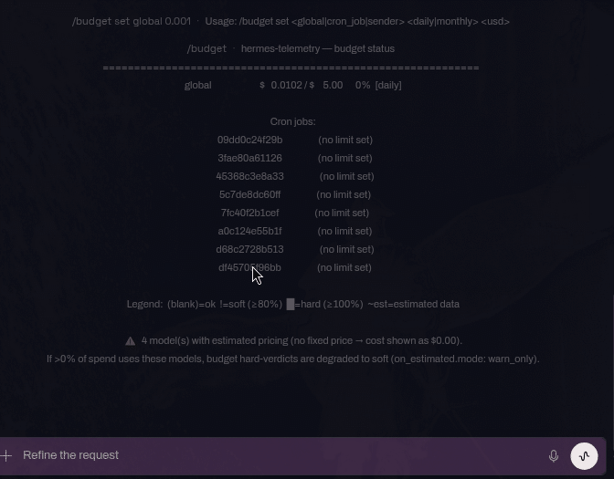

<p align="center">
  
</p>

> *Observability + budget guardrails for [Hermes Agent](https://github.com/NousResearch/hermes-agent)*

**Budget enforcement + observability for Hermes Agent. A plugin that can stop a run from doing more work once it is over budget, not just report it afterwards.**

A comprehensive telemetry plugin that captures real usage data, enforces budget limits, and provides detailed cost analysis for AI agent operations. Built for the [Hermes Agent Challenge](https://dev.to/devteam/join-the-hermes-agent-challenge-1000-in-prizes-13cd) by [Nadia Ujovich](https://nadiaujovich.dev).

**The differentiator: it can _stop_ further work once a budget is breached — not just report it after the fact.** Set a daily cap below current spend, and the next cron run's tool calls are blocked by the budget:



*`/budget set global daily 0.001` writes the cap to `budget.yaml`; current spend ($0.0102) already exceeds it, so `/budget` re-renders at 1020% `[daily]` — a hard breach — and the next marketing cron run is blocked by the budget.*

[](https://raw.githubusercontent.com/NousResearch/hermes-agent/HEAD/assets/banner.png)

[](https://camo.githubusercontent.com/08cef40a9105b6526ca22088bc514fbfdbc9aac1ddbf8d4e6c750e3a88a44dca/68747470733a2f2f696d672e736869656c64732e696f2f62616467652f4c6963656e73652d4d49542d626c75652e737667) [](https://img.shields.io/badge/Tests-698%20passing-green.svg) [](https://img.shields.io/badge/Providers-OpenRouter-orange.svg) [](https://camo.githubusercontent.com/d0c993fdf35127e435629279025d4b1892e351f5e04ce1547329686aa4223366/68747470733a2f2f696d672e736869656c64732e696f2f62616467652f4865726d65732532304167656e742d4368616c6c656e6765253230456e7472792d707572706c652e737667)

-----

Hermes Agent runs autonomously — across sessions, platforms, and cron jobs — which
means it can keep spending even when you're not watching.
**hermes-telemetry lives inside the runtime**, records every API and tool call, and
enforces budget limits at the tool-call gate: once a hard limit is breached, every
further tool call is blocked, and a breached cron-job budget also pauses that job. Hermes cannot abort a
model call that is already in flight, so that response still completes and is billed —
see [Budgets](https://nujovich.github.io/hermes-telemetry/guides/budgets/) for exactly
what enforcement can and cannot stop.

> This plugin targets a gap raised repeatedly in the Hermes tracker: **budget
> enforcement for unattended runs** — blocking further work once spend passes a cap,
> not just reporting it after the fact (see [#23419](https://github.com/NousResearch/hermes-agent/issues/23419)
> and [#26382](https://github.com/NousResearch/hermes-agent/issues/26382)). It
> complements — it does not replace — the first-class telemetry work in
> [#51714](https://github.com/NousResearch/hermes-agent/pull/51714).

```
Your Hermes session
  ↓ every API call and tool call
hermes-telemetry (runtime-integrated plugin)
  → records tokens, cost, latency, and tool calls
  → injects a one-time notice at the soft budget limit
  → blocks every further tool call at the hard limit
  → logs to SQLite with WAL mode
  → syncs OpenRouter pricing automatically
  ↓
LLM provider and tools
```

> **Not a log reader.** TokenTelemetry and similar tools read what already happened.
> hermes-telemetry hooks into the Hermes runtime and can *stop* what happens next.

**Design principle:** observability is invisible to the model. Everything goes through hooks. The only user-facing surfaces are `/stats`, `/budget`, and `/setup`.

-----

## Documentation

> ### 📖 Full documentation: **<https://nujovich.github.io/hermes-telemetry/>**

| Topic | Page |
|-------|------|
| What it measures | [Introduction](https://nujovich.github.io/hermes-telemetry/getting-started/introduction/) |
| Install, enable, update | [Installation](https://nujovich.github.io/hermes-telemetry/getting-started/installation/) |
| First data in minutes | [Quick start](https://nujovich.github.io/hermes-telemetry/getting-started/quick-start/) |
| First-load defaults and `/setup` | [Setup wizard](https://nujovich.github.io/hermes-telemetry/getting-started/setup-wizard/) |
| `/stats` and `/budget` in chat | [Slash commands](https://nujovich.github.io/hermes-telemetry/guides/slash-commands/) |
| Terminal usage, date filters, JSON | [Standalone CLI](https://nujovich.github.io/hermes-telemetry/guides/standalone-cli/) |
| Both web dashboards, remote access | [Dashboard](https://nujovich.github.io/hermes-telemetry/guides/dashboard/) |
| `budget.yaml`, soft and hard enforcement | [Budgets](https://nujovich.github.io/hermes-telemetry/guides/budgets/) |
| `pricing.yaml`, auto-refresh, snapshots | [Pricing](https://nujovich.github.io/hermes-telemetry/guides/pricing/) |
| Shared telemetry home, `sync-profiles` | [Profiles and shared home](https://nujovich.github.io/hermes-telemetry/guides/profiles/) |
| Verify your provider reports usage | [Provider probe](https://nujovich.github.io/hermes-telemetry/guides/provider-probe/) |
| Files, environment variables | [Configuration](https://nujovich.github.io/hermes-telemetry/reference/configuration/) |
| What it cannot do | [Known limitations](https://nujovich.github.io/hermes-telemetry/reference/known-limitations/) |
| Common problems | [Troubleshooting](https://nujovich.github.io/hermes-telemetry/reference/troubleshooting/) |
| Recorded end-to-end validation | [Proof of concept](https://nujovich.github.io/hermes-telemetry/reference/proof-of-concept/) |
| Hooks, database schema, concurrency | [Internals](https://nujovich.github.io/hermes-telemetry/internals/) ([Hook pipeline](https://nujovich.github.io/hermes-telemetry/internals/hook-pipeline/), [Database layer](https://nujovich.github.io/hermes-telemetry/internals/database-layer/)) |
| Release history | [Changelog](https://nujovich.github.io/hermes-telemetry/reference/changelog/) |

-----

## Table of Contents

- [Documentation](#documentation)
- [Installation](#installation)
- [Quick Start](#quick-start)
- [Running Tests](#running-tests)
- [Comparison](#comparison)
- [License](#license)
- [Hermes Agent Challenge](#hermes-agent-challenge)

-----

## Installation

Hermes plugins are **opt-in** — you must both install and enable the plugin.

```
hermes plugins install nujovich/hermes-telemetry
hermes plugins enable hermes-telemetry
hermes gateway restart
```

Prefer a manual install? `git clone https://github.com/nujovich/hermes-telemetry ~/.hermes/plugins/hermes-telemetry`
and enable it the same way. Plugin changes only take effect after a gateway restart. The
[Installation guide](https://nujovich.github.io/hermes-telemetry/getting-started/installation/)
covers the command-line tool, the dashboard plugin, and updating.

-----

## Quick Start

1. Install and enable the plugin, then restart the gateway
1. Run any session, then type `/stats` to see captured data
1. Optionally review `pricing.yaml` and `budget.yaml`, which the setup wizard generates on first load

That's it. The plugin captures data automatically — no agent action required. Cost is
always an estimate computed from a local pricing table; see
[What it measures](https://nujovich.github.io/hermes-telemetry/getting-started/introduction/#what-it-measures).

-----

## Comparison

|                  |hermes-telemetry|TokenTelemetry       |Martin Loop         |
|------------------|----------------|---------------------|--------------------|
|Hermes-native     |✅ Native plugin |❌ Reads external logs|❌ No Hermes support |
|Budget enforcement|✅ Blocks further tool calls|❌ Observe only       |✅ But not for Hermes|
|Real-time         |✅ Pre-tool-call |❌ Post-hoc           |✅ Pre-attempt       |
|Requires Hermes   |✅ Hermes only   |Any agent            |Claude Code / Codex |
|Local dashboard   |✅               |✅ (more complete)    |❌                   |
|Open source       |✅ MIT           |✅ MIT                |✅ MIT               |

**When to use TokenTelemetry instead:** if you need a multi-agent dashboard (Claude Code + Codex + Hermes in one place), TokenTelemetry is the right choice. hermes-telemetry is purpose-built for Hermes operators who need budget enforcement, not just visibility.

-----

## Running Tests

```
cd hermes-telemetry
pip install pytest pyyaml
pytest tests/ -v
```

**Test suite (704 tests, 698 passing + 6 skipped):**

|File                             |Tests|Coverage                                                                                                                       |
|---------------------------------|-----|-------------------------------------------------------------------------------------------------------------------------------|
|`test_db.py`                     |116  |Schema migrations (v1→v17, incl. the #89 known-free repair), CRUD, aggregations, concurrent WAL writes, `known_free_models`, pricing snapshots, subagent edges, cache layer|
|`test_pricing.py`                |107  |Cache/reasoning split, no double-counting of `prompt_tokens`, YAML overrides, prefix matching, provider-aware source guard, NIM seeds (incl. `nemotron-3-ultra` paid + `:free` suffix → $0 rule), subscription tag, unknown model handling, `is_explicitly_priced`, `get_known_free_models`, `snapshot_to_price`/`core_price` priority (core-pricing-primary)|
|`test_dashboard.py`              |47   |HTML dashboard rendering, auto-refresh, chart data endpoints, viewer-timezone budget windows, cache layer (TTL / serve-stale)  |
|`test_telemetry_cli.py`          |48   |CLI subcommands (stats/budget/pricing/sync-profiles), all window variants, text + `--json` output, entry point smoke test, tracked exec bit on the standalone binary and the pre-commit hook, date-range label edge cases|
|`test_budget.py`                 |36   |ok/soft/hard verdicts, estimated-to-soft degradation, anti-spam ledger, cron pause, per-scope routing, `/budget set` (default + per-profile/id override) hot-reload|
|`test_dashboard_plugin_api.py`   |34   |Plugin dashboard API: per-profile scoping clauses, efficiency/smells/budget endpoints                                          |
|`test_pricing_drift.py`          |33   |Drift vs core snapshots: threshold, subscription skip, canonical collapse, provider-assumed routing, `--apply` write-back, multi-provider recency, malformed-YAML safety, CLI|
|`test_sync_profiles.py`          |29   |Profile consolidation via `HERMES_TELEMETRY_HOME`: `.env` upsert, name scoping, template preservation                          |
|`test_stats_smells.py`           |22   |Anti-pattern (smell) detection and scoring                                                                                     |
|`test_packaging.py`              |4    |Packaging contract: pyyaml declared in `[project].dependencies`, every runtime dependency upper-bounded, setuptools maps the repo root to `hermes_telemetry`, wizard module is not named `setup.py`|
|`test_dashboard_html_escaping.py`|1   |Standalone dashboard never interpolates `err.message` into HTML unescaped                                                        |
|`test_setup.py`                  |23   |First-time setup wizard, pricing/budget file generation, interactive + non-interactive paths                                   |
|`test_pricing_snapshots.py`      |24   |Core-sourced pricing snapshots: append-per-change, `resolved_model` canonicalization, capture throttle, incomplete-snapshot fallback|
|`test_observation_mode.py`       |10   |Enforce-default mode, upgrade path (no get_config still blocks), observe opt-in, watcher always on, /budget not-enforced notice, mode normalisation (case/whitespace, non-string → enforce)|
|`test_init.py`                   |27   |Cron session ID regex, tool success/failure parsing, free→paid transition alert (detection, queueing, injection, backfill)     |
|`test_stats_models.py`           |19   |Per-model breakdown, `/stats models` output format                                                                             |
|`test_subagent_reconciliation.py`|15   |Parent + child hook sequence, token reconciliation, no double-counting                                                         |
|`test_pricing_refresh.py`        |23   |Auto-refresh from OpenRouter API, change detection, manual override preservation, subscription-model metadata, `HERMES_TELEMETRY_HOME` resolution|
|`test_stats_providers.py`        |15   |Real vs estimated per provider, `/stats providers` output format, Nous warning dedup                                           |
|`test_stats_efficiency.py`       |12   |Per-session efficiency scoring (0–100)                                                                                         |
|`test_moa.py`                    |11   |Mixture-of-Agents (MoA) telemetry capture                                                                                      |
|`test_sync_profiles_cli.py`      |7    |`sync-profiles` CLI wiring, dry-run + `--apply`                                                                                |
|`test_pricing_backfill.py`       |7    |Seed pricing snapshots for historical models (coverage seed, fail-open, idempotent)                                            |
|`test_paths.py`                  |6    |Telemetry path resolution precedence: `HERMES_TELEMETRY_HOME` > `HERMES_HOME` > `~/.hermes`                                     |
|`test_dashboard_plugin_isolation.py`|6 |Enforces zero shared Python code between the two dashboard surfaces                                                             |
|`test_isolation.py`              |5    |`HERMES_HOME` redirect, no writes to real `~/.hermes`                                                                          |
|`test_pricing_hot_reload.py`     |3    |In-process cache invalidation on pricing update                                                                                |
|`test_moa_integration.py`        |3    |MoA end-to-end integration                                                                                                     |
|`test_budget_per_profile.py`     |3    |Per-profile budget scoping                                                                                                     |
|`test_profile_capture.py`        |2    |Per-profile attribution capture                                                                                                |
|`test_logging_isolation.py`      |2    |Plugin logger state isolation between tests                                                                                    |
|`test_ci_config.py`              |4    |Lint toolchain pin: `.ruff-version` is the single source of truth, CI installs from it, the pre-commit hook warns on version skew, `*.md` excluded from formatting|

No live Hermes is required — all tests are self-contained with in-memory SQLite.

-----

## License

MIT — see [LICENSE](https://github.com/nujovich/hermes-telemetry/blob/main/LICENSE).

-----

## Hermes Agent Challenge

This plugin was built for the [**Hermes Agent Challenge**](https://dev.to/devteam/join-the-hermes-agent-challenge-1000-in-prizes-13cd) — a $1,000 competition to build the most useful Hermes Agent plugins and extensions.

**🔗 Challenge Entry:** [hermes-telemetry on dev.to](https://dev.to/devteam/join-the-hermes-agent-challenge-1000-in-prizes-13cd)

**🛠️ Built by:** [Nadia Ujovich](https://github.com/nujovich)

**💡 Why this plugin:** Every AI system needs observability and cost control. This plugin gives Hermes Agent users the visibility to optimize their workflows and the guardrails to prevent bill shock — essential for production deployments and automated cron jobs.

-----

*Made with ☕ for the Hermes Agent ecosystem*
