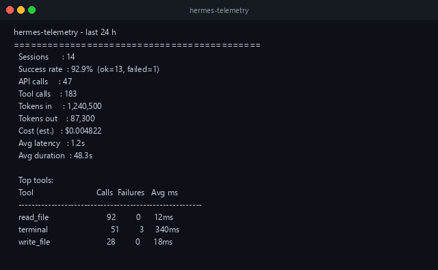
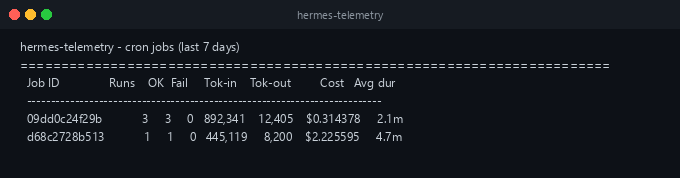
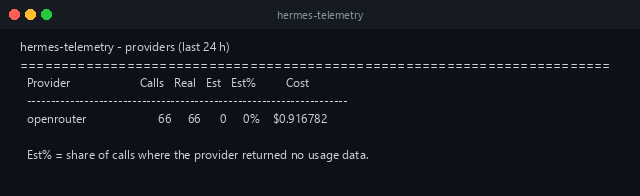
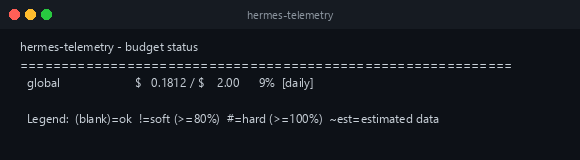

hermes-telemetry adds three slash commands to Hermes chat: `/stats`, `/budget`, and [`/setup`](/hermes-telemetry/getting-started/setup-wizard/). The plugin is otherwise invisible to the model: everything else happens through hooks.

[](https://github.com/nujovich/hermes-telemetry/raw/main/docs/screenshots/stats-output.png)

## `/stats`

```text
/stats                  last 24 hours: sessions, tokens, cost, top tools
/stats today            same as /stats
/stats week             last 7 days
/stats month            last 30 days
/stats cron             breakdown by cron job (last 7 days)
/stats cron today       cron breakdown, last 24 hours
/stats cron week        cron breakdown, last 7 days
/stats cron month       cron breakdown, last 30 days
/stats providers        per provider: real vs estimated calls and cost (last 24 hours)
/stats providers week   provider breakdown, last 7 days
/stats models           per model within each provider (last 24 hours)
/stats models week      model breakdown, last 7 days
/stats errors           failed LLM attempts by error type and provider/model (last 24 hours)
/stats errors week      failed-attempt breakdown, last 7 days
/stats efficiency       per-session efficiency scores (last 24 hours)
/stats efficiency week  efficiency scores, last 7 days
/stats smells           anti-pattern detection (last 24 hours)
/stats smells week      anti-pattern detection, last 7 days
/stats raw [N]          last N raw run records (default 20, maximum 200)
```

`providers`, `models`, `efficiency`, and `smells` also accept `today` and `month`.

### Profile filter

Add `--profile <name>` to restrict a view to runs tagged with one Hermes profile. `--profile -` selects the unattributed bucket: runs with no profile recorded. It works on the summary, `cron`, `providers`, `models`, `efficiency`, `smells`, and `raw` views and combines with `--from` and `--to`. The block header names the applied filter.

```text
/stats models --profile faro
/stats cron --profile faro --from 2026-06-10
/stats --profile -
```

LLM calls that have no matching run row are not attributed to any profile, so every profile filter excludes them, `--profile -` included.

### Date ranges

Any `/stats` subcommand accepts `--from` and `--to` to replace the preset window with an arbitrary range. This is useful for isolating data from after a deploy or a pricing fix without waiting for a rolling window to age out.

```text
/stats models --from 2026-06-16T12:00:00Z
/stats providers --from 2026-06-10 --to 2026-06-15
/stats --from 2026-06-16
```

`--from` is inclusive and `--to` is exclusive. A date without a time means 00:00:00 UTC of that day. The standalone CLI parses the same flags: see [Standalone CLI](/hermes-telemetry/guides/standalone-cli/#date-range-filters).

### Summary

```text
hermes-telemetry — last 24 h
============================================
  Sessions      : 14
  Success rate  : 92.9%  (ok=13, failed=1)
  API calls     : 47
  Tool calls    : 183
  Tokens in     : 1,240,500
  Tokens out    : 87,300
  Cost (est.)   : $0.004822
  Avg latency   : 1.2s
  Avg duration  : 48.3s

  Top tools:
  Tool                            Calls  Failures   Avg ms
  --------------------------------------------------------
  read_file                          92         0      12ms
  terminal                           51         3     340ms
  write_file                         28         0      18ms
```

When some calls used estimated tokens, the cost is prefixed with `~` and an `Estimated data` line shows the share of affected API calls.

When the period contains failed LLM attempts, a line such as `Failed attempts: 3  (6.0% error rate — see /stats errors)` follows the API calls count. The error rate is failed attempts divided by failed attempts plus successful LLM calls, so a call that is retried twice before succeeding counts as two failures and one success. The line is omitted when there are no failures.

### Cron jobs

[](https://github.com/nujovich/hermes-telemetry/raw/main/docs/screenshots/cron-output.png)

```text
hermes-telemetry — cron jobs (last 7 days)
========================================================================
  Job ID               Runs    OK  Fail     Tok-in    Tok-out         Cost   Avg dur
  --------------------------------------------------------------------------
  09dd0c24f29b            3     3     0   892,341    12,405    $0.314378     2.1m
  d68c2728b513            1     1     0   445,119     8,200    $2.225595     4.7m
```

### Providers

`/stats providers` shows, for each provider, how many calls reported real usage and how many were estimated.

[](https://github.com/nujovich/hermes-telemetry/raw/main/docs/screenshots/providers-output.png)

```text
hermes-telemetry — providers (last 7 days)
========================================================================
  Provider                      Calls   Real   Est   Est%   Asm%         Cost
  ---------------------------------------------------------------------------
  anthropic                        39     35     4    10%     0%    $5.211578
  openai                           69     61     8    12%     0%    $1.064379
  openrouter                       17     13     4    24%     0%    $0.075388
```

- **`Est%`** is the share of calls where the provider returned no usage data, so tokens were estimated locally. If it is above zero for your main provider, hard budget verdicts can be degraded to soft. See [Budgets](/hermes-telemetry/guides/budgets/#estimated-data-and-budget-degradation).
- **`Asm%`** is the share of calls priced with an assumed rate: a price from another source applied because no provider-native rate was registered. See [Pricing](/hermes-telemetry/guides/pricing/).

The provider label is whatever the Hermes gateway reports for each call. It is not derived from the model name, so anything routed through OpenRouter appears under `openrouter`.

### Models

`/stats models` breaks each provider's spend down to individual models, grouped by provider and ordered by call count.

```text
hermes-telemetry — models (last 24 h)
============================================================================================================
  Provider             Model                                           Calls   Real   Est         Cost  Notes
  ----------------------------------------------------------------------------------------------------------
  nous                 deepseek/deepseek-v4-pro-20260423                 449    448     1    $2.318788
  nous                 tencent/hy3-20260706:free                         153    153     0    $0.000000  free tier
  nous                 qwen3.7-plus                                       80     80     0    $0.000000  subscription/free-tier
  openrouter           some/unpriced-model                                12     12     0    $0.000000  no price entry
```

The `Notes` column explains every `$0.000000` row, so you can tell an intentional zero from missing pricing:

| Note | Meaning |
| --- | --- |
| `subscription/free-tier` | The model is declared with `_subscription: true` in `pricing.yaml`. The zero is intentional, and pricing refresh preserves the entry. |
| `free tier` | The model resolves to an explicit `$0` on its own: an id ending in `:free` (including dated ids such as `tencent/hy3-20260706:free`) or a built-in `$0` price. It is recorded as known-free and never triggers the estimated-price warning. |
| `no price entry` | Nothing in `pricing.yaml` or the built-in table prices this model, so Hermes had nothing to multiply by. Add an entry to `pricing.yaml` manually. `/setup pricing auto` regenerates the whole file and overwrites hand edits, so back it up first. |

The footer summarizes each applicable group.

### Errors

`/stats errors` shows every failed LLM attempt recorded for the period, grouped two ways: by error type and HTTP status, and by provider and model. Each group has a count and the time it was last seen (UTC). Use `week` or `month` for a longer window.

```text
hermes-telemetry — errors (last 24 h)
========================================================================
  Failed attempts: 5  (4.5% of 111 attempts)

  By error type:
  Error type                         Status  Count  Last seen (UTC)
  ------------------------------------------------------------------
  rate_limit_error                      429      4  2026-11-12 09:41
  APITimeoutError                         -      1  2026-11-12 08:02

  By provider / model:
  Provider       Model                              Count  Last seen (UTC)
  --------------------------------------------------------------------------
  nous           deepseek/deepseek-v4-pro-20260423      5  2026-11-12 09:41
```

Rows are per failed attempt: the ledger does not deduplicate retries. A dash in `Status` means the failure had no HTTP status (a timeout or connection error, for example). The view honors `--from`, `--to`, and `--profile`.

The ledger keeps 30 days by default and prunes older rows automatically; see the `HERMES_TELEMETRY_ERROR_RETENTION_DAYS` setting in [Configuration](/hermes-telemetry/reference/configuration/#environment-variables).

### Efficiency and smells

`/stats efficiency` gives every session a productivity score from 0 to 100, computed from data already in the database. A higher output-to-input token ratio, fewer API turns, and a clean finish score higher. `/stats smells` flags anti-patterns such as context rotation, loop traps, tool thrashing, high error rates, and massive sessions, each with a severity of `HIGH`, `MED`, or `WARN`.

```text
hermes-telemetry -- efficiency score (last 24 h)
========================================================================
  Average efficiency: 71.4/100
  Sessions scored: 12

   Score Status        APICalls    Tok in   Tok out         Cost  Session
  -------------------------------------------------------------------------------------
    97.0 ok                   2       200       400    $0.002000  9f2c1a7b8e04
    68.5 interrupted          1       100       100    $0.001000  1c0d44ab90f2
    48.5 error                1       100       100    $0.001000  7a3e55cd21b8
```

Both features are heuristics over existing telemetry. A failing detector is logged and skipped rather than crashing the command. For the exact formula and every threshold, see [Agent intelligence](/hermes-telemetry/internals/agent-intelligence-efficiency-smells-forecast/) in the Internals section.

## `/budget`

```text
/budget                                       status of every scope (spent / limit / %)
/budget cron                                  per-cron-job budgets
/budget set global daily 5.00                 set or raise a limit
/budget set cron_job daily 1.00               default limit for every cron job
/budget set sender daily 2.00                 default limit for every sender
/budget set profile daily 2.00                default limit for every profile
/budget set profile faro monthly 50           override for one profile
/budget forecast [daily|monthly] [scope] [id] project the burn rate toward the limit
```

[](https://github.com/nujovich/hermes-telemetry/raw/main/docs/screenshots/budget-output.png)

### Setting limits

The full form is `set <scope> [<id>] <window> <usd>`. Scopes are `global`, `cron_job`, `sender`, and `profile`; windows are `daily` and `monthly`. With an id, the command writes a per-id override. Without one, it writes the scope's `default` bucket. `global` takes no id.

`/budget set` writes `budget.yaml` atomically and applies immediately, because it runs inside the gateway. On the standalone CLI the id is a flag instead: `hermes-telemetry budget set profile monthly 50 --id faro`. The CLI runs in a separate process, so the gateway picks the change up through its file watcher (`watchdog`) or after a restart.

### Status

```text
hermes-telemetry — budget status
============================================================
  global                       $   0.1812 / $    2.00      9%  [daily]

  Profiles:
    faro                         $   3.0000 / $   20.00     15%  [monthly]
    default                      $   0.5000 / $    5.00     10%  [daily]

  Legend:  (blank)=ok  !=soft (≥80%)  █=hard (≥100%)  ~est=estimated data
```

| Flag | Meaning |
| --- | --- |
| (blank) | Within budget (below 80%) |
| `!` | Soft warning (80% or more): a one-time notice is injected into the conversation |
| `█` | Hard breach (100% or more): further tool calls are blocked, and a breaching cron job is paused |
| `~est` | The verdict rests partly on estimated data |

Besides `global`, the status block lists every `cron_job`, `sender`, and `profile` scope that had activity in the last 30 days. A scope with a configured limit but no recent runs gets no section; there is simply nothing to report yet. In `observe` mode, when a `budget.yaml` exists, the block opens with a notice that limits are not enforced.

### Forecast

`forecast` defaults to the `monthly` window and the `global` scope. It computes a recent daily spend rate (a 14-day moving average), projects spend to the end of the current window at that rate, and flags whether the scope is on track to breach. It is a read-only projection and never changes budget state.

```text
hermes-telemetry — burn-rate forecast
============================================================
  Scope:    global (monthly)
  Limit:    $100.00
  Spent:    $42.5000
  Avg/day:  $3.1000 (last 14d)
  Projected $85.30 (85%) by window end
  At this rate: breach in ~18.5 days
  ! Projected status: SOFT
```

The projected status uses the same thresholds as `/budget`. A scope with no limit configured for the requested window is reported as not configured.

For what a soft or hard verdict actually does, see [Budgets](/hermes-telemetry/guides/budgets/).
